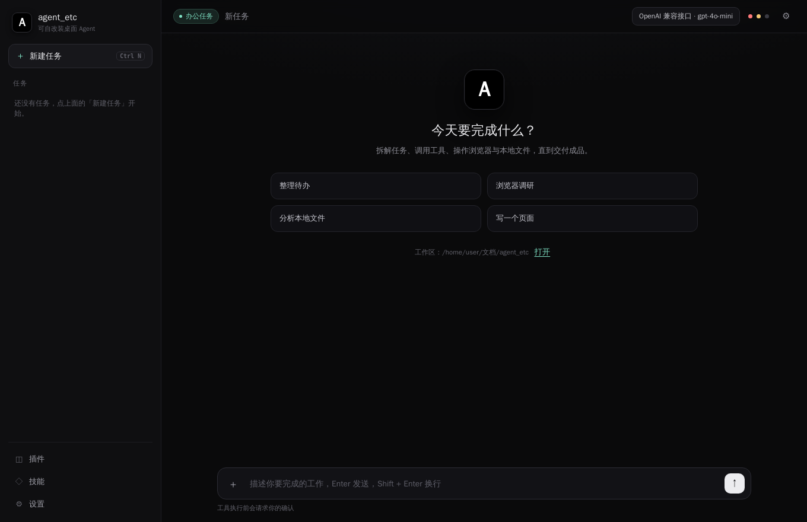

# agent_etc

一个**可自改装的桌面 Agent 工作台**：像豆包「办公任务模式」那样拆解任务、调用工具、操作浏览器，但模型、插件、权限、骨架全部由你自己配置。所有会话与配置都保存在本机。



## 它是什么

| 维度 | 说明 |
| --- | --- |
| 形态 | Electron 桌面应用，Windows 安装包 / 便携版单文件 exe |
| 模型 | 任意 OpenAI 兼容接口（OpenAI、DeepSeek、Moonshot、vLLM、Ollama、llama.cpp），Anthropic Messages API，本地 GGUF |
| 工具 | 文件读写、Shell、网页抓取、浏览器自动化（CDP）、剪贴板、HTTP、插件与 MCP 工具 |
| 插件 | 原生 JS 插件目录 + 任意 MCP 服务器（stdio JSON-RPC），可开关、可卸载 |
| 权限 | Shell / 写文件 / 网络 / 页面脚本分别可设为「询问 / 自动 / 禁止」 |
| 数据 | 全部本地：配置、会话、密钥、插件、工作区文件 |

## 快速开始

1. 安装 `agent_etc-1.1.0-x64.exe`，或直接运行 `agent_etc-1.1.0-portable.exe`。
2. 打开 **设置 → 模型服务**，填 Base URL、API Key、模型名，点「测试连接」，再「设为当前」。
3. 回到主界面，输入任务，例如「读取工作区里的 CSV，做一份分析并写成报告」。

### 本地 GGUF 模型

1. **设置 → 本地 GGUF**：点「自动安装引擎」，agent_etc 会从 llama.cpp 官方 Release 抓取当前 Windows 构建的 CPU 包（`llama-b*-bin-win-cpu-x64.zip`）并解压到用户数据目录；也可以手动选择已有的 `llama-server.exe`。
2. 选择 `.gguf` 模型，按显存调整 GPU 层数（0 = 纯 CPU）。
3. 点「启动模型服务」。就绪后会自动把当前模型切到本地，后续对话全部离线。

> 选错引擎不会静默失败：如果指向 MNN 的 `llm_demo.exe`，界面会直接提示它只接受 `config.json`、不能加载 `.gguf`，并给出修复入口。

> 纯 CPU 也能跑：GPU 层数填 0，上下文按内存调整（7B 模型建议 4096–8192）。

### 浏览器操作

Agent 通过 Chrome DevTools Protocol 操作你本机的 Chrome / Edge，**保留真实登录态**：

- `browser_open` 打开页面，`browser_read` 读正文；
- `browser_click` / `browser_type` 支持 CSS 选择器或可见文字；
- `browser_screenshot` 截图落到工作区 `screenshots/`。

首次调用会自动拉起一个独立配置目录的浏览器实例，需要登录时在弹出的窗口里手动登录一次即可。

## 插件

### 原生插件

在用户数据目录 `plugins/<id>/` 放两个文件：

```json
// plugin.json
{ "id": "hello", "name": "示例", "version": "1.0.0", "main": "index.js" }
```

```js
// index.js
module.exports = {
  activate(ctx) {
    ctx.registerTool({
      name: 'hello_world',
      description: '打个招呼',
      parameters: { type: 'object', properties: { name: { type: 'string' } } },
      async run(args) { return { hello: args.name || 'world' }; },
    });
  },
};
```

`ctx` 提供 `registerTool`、`getConfig`、`workspace`、`log`、`pluginDir`；工具可标记 `danger: true` 以触发确认弹窗。

### MCP 服务器

**设置 → 插件 → 添加 MCP 服务器**，填命令与参数即可，例如：

```
命令: npx
参数: -y @modelcontextprotocol/server-filesystem D:\data
```

启动后其工具会自动并入 Agent 的工具列表（前缀 `mcp_<server>_`）。

## 技能（豆包 / DeepSeek Harness 双格式）

技能是注入系统提示的 Markdown，用来固化流程与口径。**设置 → 技能** 支持两种来源：

- 单文件 `xxx.md`（豆包 / 通用），可选 YAML front matter（`name`、`description`）；
- 目录 + `SKILL.md`（DeepSeek Harness / Claude 风格），目录里的引用文件会一起保留。

可以「导入技能文件」「导入技能目录」「从 DeepSeek Harness 导入」（自动扫描 `~/.dsh/skills` 等），也支持 `.zip`。导入只复制到用户数据目录，不改原文件；每个技能可单独开关、打开编辑、删除。

## Android 独立版（1.4.0）

`agent_etc-1.4.0-android.apk` 是**真正不依赖电脑**的手机 App：Agent 循环、会话、记忆、工具和 llama.cpp 推理都在手机内，不需要电脑开着。

- **云端**：设置里填你自己的 OpenAI 兼容接口（DeepSeek / Kimi / OpenAI / Ollama / 自建），Key 只存本机；
- **本地 GGUF**：从系统文件选择器导入 `.gguf`（建议 0.5B–3B Q4），复制到应用私有目录后离线推理；
- **手机工具**：应用私有文件读写、打开浏览器、GET 网页、分享、剪贴板、记忆、弹窗询问；
- **不预置任何豆包接口**，不调用豆包额度；云端费用由你自己的 API 承担，本地模式完全离线；
- 人机验证/验证码/支付：检测到就让用户本人完成，不代过。

构建：

```bash
bash scripts/fetch-llama-src.sh          # 下载 b12405 源码到 android-standalone/llama.cpp
bash scripts/build-standalone-apk.sh     # arm64-v8a，NDK r26d，输出 dist/agent_etc-1.4.0-android.apk
```

> 1.3.0 的 25KB APK 是连接电脑的远程壳，已不是推荐用法；独立版请用 1.4.0。

## 手机远程版（可选）

**设置 → 手机版** 开启后，主进程会在局域网起一个带令牌的轻量服务，手机浏览器可直接使用电脑端的模型与工具：

- 手机与电脑连同一 Wi-Fi，打开面板里显示的地址（`http://电脑IP:端口/?t=令牌`）；
- 和桌面端共享会话、工具、模型；工具执行前手机上确认；
- 适合想用电脑大模型、又只想在手机上看进度的情况。

## 权限与安全

- 默认所有有副作用的操作都弹窗确认；可在 **设置 → 权限与工作区** 改成自动。
- 写文件默认限制在工作区，Shell 命令展示完整内容后再执行。
- API Key 保存在本机配置文件，不会上传；请勿把包含 Key 的配置文件提交到仓库。

## 开发与构建

```bash
npm install
npm start                  # 本地运行
npm run icon               # 生成图标（需要 Python + Pillow）
npm run dist:win           # 交叉编译 Windows（Linux 上需要 wine）
```

构建产物在 `dist/`：

- `agent_etc-1.0.0-x64.exe`：NSIS 安装程序（可选安装目录、桌面快捷方式）
- `agent_etc-1.1.0-portable.exe`：便携版单文件
- `win-unpacked/`：免安装目录版

## 代码签名

仓库提供 `scripts/make_cert.sh` 与 `scripts/sign.sh`，会生成 **ETC Root CA → ETC Code Signing** 两级证书并签名所有 exe。

```bash
bash scripts/make_cert.sh
npm run dist:win
bash scripts/sign.sh
```

签名后的 exe 带有 `CN=ETC` 的 Authenticode 签名。由于是自签发证书，Windows 默认不信任；把 `ETC-Root.crt` 安装到「受信任的根证书颁发机构」后，`signtool verify /pa` 即可通过。详见 [docs/CODE_SIGNING.md](docs/CODE_SIGNING.md)。

## 目录结构

```
src/main/            主进程：Agent 循环、模型适配、工具、插件、本地模型
src/preload/         安全桥（contextIsolation）
src/renderer/        界面（无框架，纯 HTML/CSS/JS）
plugins/builtin/     内置插件：系统信息、HTTP 客户端、剪贴板
skills/              内置技能（注入系统提示的 Markdown）
scripts/             图标、证书、签名、自测脚本
```

## 许可

MIT
